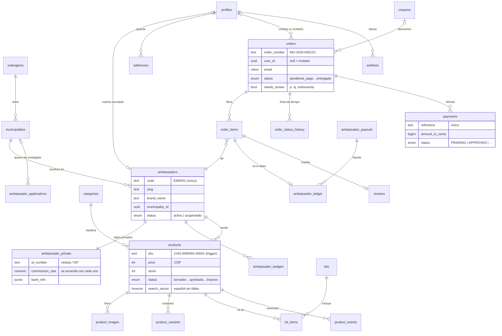

# Fase 1 · Base de datos de Mercado Origen

Migraciones en [supabase/migrations](../supabase/migrations), semilla en [supabase/seed](../supabase/seed) y pruebas en [supabase/checks/rls_and_logic.sql](../supabase/checks/rls_and_logic.sql).

## Diagrama de tablas

Además hay tablas de soporte: `sku_counters` (consecutivos), `coupon_redemptions`, `payment_events` (idempotencia del webhook), `newsletter_subscribers`, `shipping_settings`, `faqs`, `site_settings` y `audit_log`. La vista `kit_summaries` calcula el precio por separado, el ahorro y la disponibilidad de cada kit.

## Políticas RLS

RLS está activa en las 32 tablas. El admin tiene acceso total en todas mediante `is_admin()`. Las Edge Functions usan `service_role`, que ignora la RLS.

| Tabla | Visitante | Cliente | Embajador | Escritura |
|---|---|---|---|---|
| subregions, municipalities, faqs, site_settings, shipping_settings | lee | lee | lee | admin |
| categories | lee activas | lee activas | lee activas | admin |
| ambassadors | lee activos | lee activos | + la suya | el embajador edita su vitrina; municipio, estado, código y métricas solo el admin (trigger) |
| ambassador_private | ✕ | ✕ | lee la suya | admin |
| ambassador_badges | lee (de activos) | lee | lee | admin |
| products | lee aprobados de embajadores activos | igual | + todos los suyos | el embajador crea y edita los suyos (trigger: no aprueba, no toca SKU, insignias ni destacado); borra solo borradores sin ventas |
| product_images, product_variants | lee si el producto es visible | igual | + los suyos | dueño del producto |
| kits, kit_items, kit_summaries | lee activos | igual | igual | admin |
| ambassador_applications | envía | envía | envía | lee y gestiona solo el admin |
| profiles | ✕ | el suyo | el suyo | el suyo, sin rol ni estado (trigger) |
| addresses, wishlists | ✕ | las suyas | las suyas | las suyas |
| orders, order_status_history, payments | ✕ (invitado: RPC `guest_order` con token) | los suyos | ✕ | solo service_role / admin |
| order_items | ✕ | los de sus pedidos | sus items, sin datos del cliente | solo service_role; el embajador marca "listo" con la RPC `ambassador_mark_ready` |
| ambassador_ledger, ambassador_payouts | ✕ | ✕ | los suyos | admin |
| reviews | lee visibles | crea solo si recibió el producto | lee las de sus productos | el autor edita la suya; moderar es del admin |
| product_events | registra (con session_id) | registra los suyos | igual | lee solo el admin |
| coupons, coupon_redemptions, newsletter_subscribers, payment_events, audit_log, sku_counters | ✕ | ✕ | ✕ | admin / service_role (boletín vía RPC `subscribe_newsletter`) |

**Permisos (GRANT).** En este proyecto Supabase no da permisos por defecto, así que se declaran uno por uno. El visitante solo tiene `SELECT` sobre el catálogo público e `INSERT` en dos formularios; sobre cualquier otra tabla recibe "permiso denegado", no "0 filas". `TRUNCATE` está revocado para todos.

**Storage.** Los buckets `avatars` (2 MB, carpeta `{user_id}/`), `product-images` (5 MB, carpeta `{ambassador_id}/`) y `brand-assets` (10 MB, solo admin) son públicos para lectura y aceptan solo imágenes.

## Reglas en triggers

- **SKU** `{CAT}-{EMB}-{SEQ}`, con consecutivo atómico por embajador. Las variantes llevan el SKU base más un sufijo y los kits `KIT-{SEQ}`. Es inmutable: solo un admin lo regenera (`admin_regenerate_sku`) y el cambio queda en `audit_log`.
- **Revisión:** si el embajador edita nombre, precio, precio tachado, descripciones, categoría, fotos o precio de variante de un producto aprobado, el producto vuelve a "pendiente". Los cambios de stock no lo devuelven a revisión.
- **Pago APPROVED**, en una sola transacción:
  - bloquea el pedido y descuenta stock con `UPDATE … WHERE stock >= qty`, en orden fijo, así que el stock nunca queda negativo;
  - suma ventas a productos y embajadores y registra lo que se le debe a cada embajador en `ambassador_ledger`;
  - marca el pedido como "pagado" y escribe el historial.
  - Es idempotente: un evento repetido no descuenta dos veces.
  - Si no alcanza el stock, el pedido queda pagado y con `needs_review`.
- **Cancelar o reembolsar** devuelve el stock y anula lo que todavía no se ha liquidado.
- **Historial:** todo cambio de estado se registra en `order_status_history`, con nota opcional.
- **Calificaciones:** los promedios de producto y embajador se recalculan con cada reseña visible.
- **Auditoría:** cada acción del admin queda en `audit_log`, con los datos bancarios y de identidad enmascarados.
